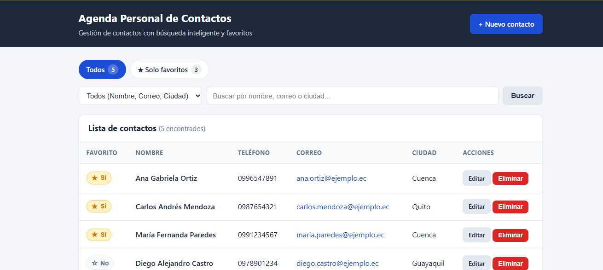
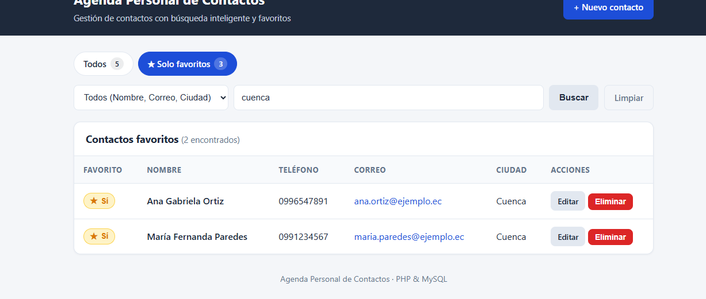
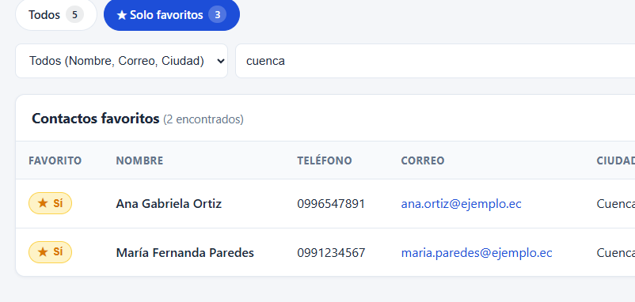

# Agenda Personal de Contactos (PHP + MySQL)

Aplicación web CRUD para gestionar una agenda personal de contactos, mejorada con **búsqueda multicampo** y **gestión de contactos favoritos**, lista para ejecutarse de forma local y desplegarse en hosting gratuito.

## URL pública

> **Enlace del sistema en funcionamiento:** http://mi-agenda-contactos.rf.gd
## Capturas de pantalla

*(Sube tus capturas a la carpeta `screenshots/` y verifica que coincidan con estos nombres)*

### Pantalla principal y listado de contactos


### Búsqueda por nombre, correo o ciudad


### Filtro de contactos favoritos


## Tecnologías utilizadas

- **Backend:** PHP 8+ con extensión PDO (sentencias preparadas para prevenir inyección SQL).
- **Base de datos:** MySQL / MariaDB.
- **Frontend:** HTML5 y CSS3 responsivo (sin dependencias externas).
- **Servidor local:** XAMPP (Apache + MariaDB + phpMyAdmin).
- **Despliegue en la nube:** InfinityFree (hosting gratuito PHP + MySQL).
- **Control de versiones:** Git y GitHub.

## Detalle de las mejoras respecto a la versión anterior

Sobre la funcionalidad base CRUD (crear, listar, editar y eliminar contactos), se implementaron **dos mejoras funcionales**:

1. **Opción A — Búsqueda de contactos:**
   - Barra de búsqueda en `index.php` que permite buscar coincidencias por **Nombre**, **Correo** o **Ciudad** (ya sea en los tres campos a la vez o seleccionando un campo específico).
   - Consultas parametrizadas con `LIKE` e índices en la tabla `contactos` (`idx_nombre`, `idx_correo`, `idx_ciudad`).
2. **Opción D — Contactos favoritos:**
   - Se incorporó el campo `favorito` (`TINYINT(1)`, donde `1 = Sí` y `0 = No`) en la tabla `contactos`.
   - Pestaña dedicada **«Solo favoritos»** para visualizar únicamente los contactos marcados como favoritos, compatible en simultáneo con la barra de búsqueda.
   - Botón interactivo de estrella (`toggle_favorito.php`) para marcar o desmarcar un contacto como favorito con un solo clic, además de la casilla en los formularios de creación y edición.

## Estructura del proyecto

```text
agenda-contactos/
├── config/
│   └── db.php              # Configuración de conexión PDO a MySQL
├── css/
│   └── styles.css          # Estilos responsivos
├── screenshots/            # Capturas de pantalla para el README
├── crear.php               # Registro de nuevos contactos
├── database.sql            # Script SQL actualizado con datos de ejemplo
├── editar.php              # Edición de contactos existentes
├── eliminar.php            # Eliminación segura vía POST
├── index.php               # Listado, búsqueda y filtro de favoritos
├── toggle_favorito.php     # Cambio rápido de estado Favorito (Sí / No)
└── README.md               # Documentación del proyecto
```

## Instrucciones para instalar el proyecto localmente

1. Instala e inicia **XAMPP** (enciende los módulos **Apache** y **MySQL**).
2. Copia la carpeta `agenda-contactos` dentro de `C:\xampp\htdocs\` (en Windows) o `/Applications/XAMPP/htdocs/` (en macOS).
3. Abre **phpMyAdmin** en `http://localhost/phpmyadmin`.
4. Crea una nueva base de datos llamada `agenda_contactos` con cotejamiento `utf8mb4_unicode_ci`.
5. Selecciona `agenda_contactos`, abre la pestaña **Importar**, elige el archivo `database.sql` y haz clic en **Importar / Continuar**.
6. Verifica que `config/db.php` tenga los datos locales (`localhost`, `agenda_contactos`, `root`, contraseña vacía `''`).
7. Abre en tu navegador: `http://localhost/agenda-contactos/`.
